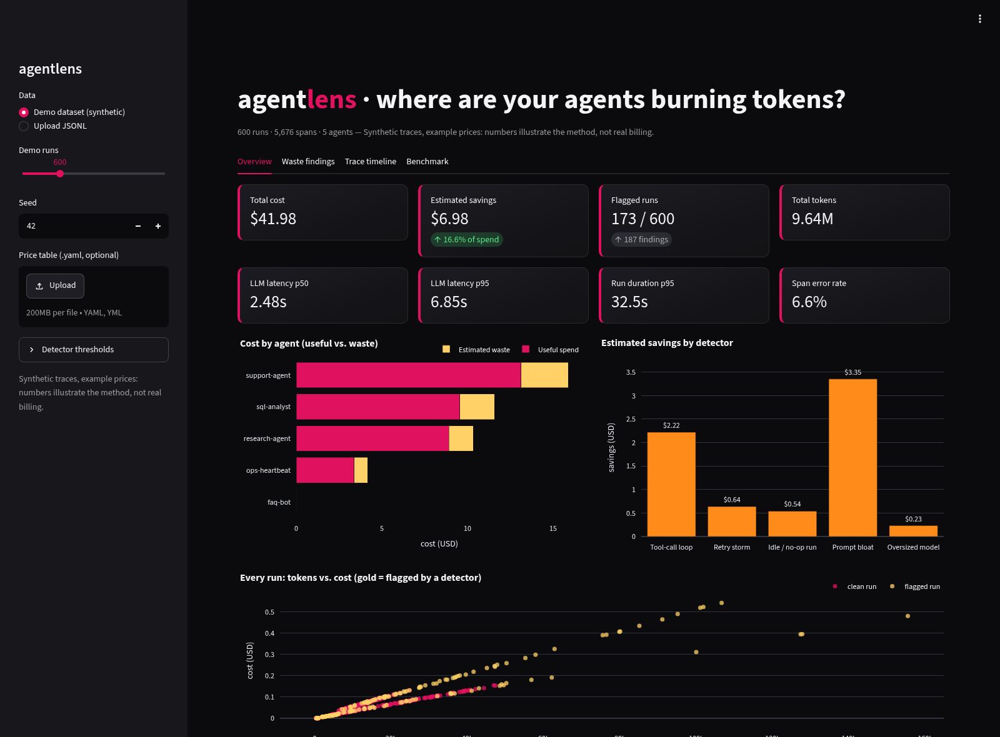
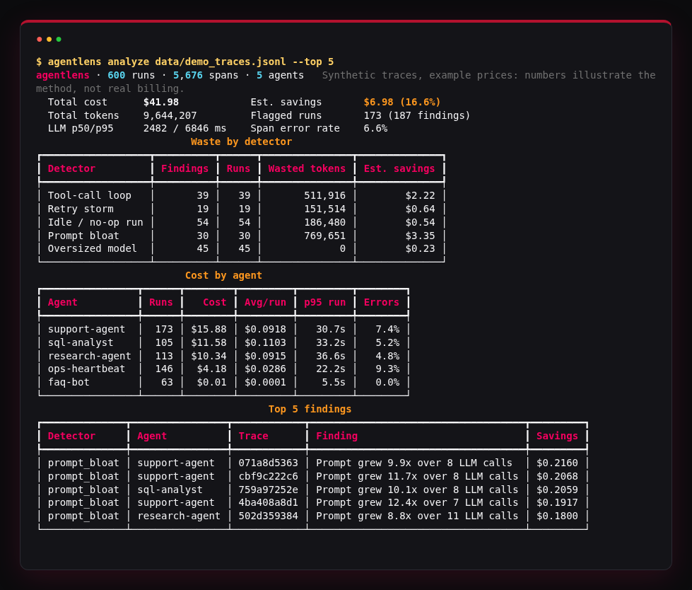
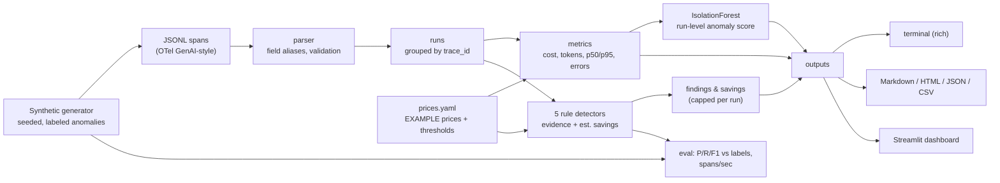
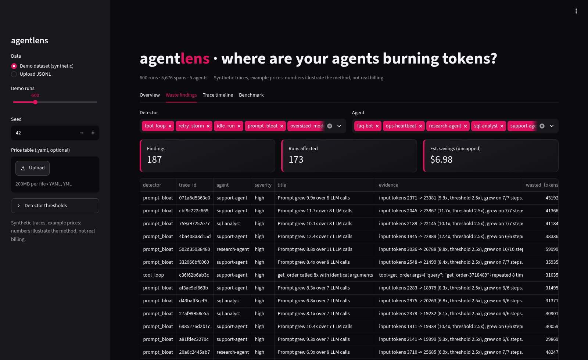
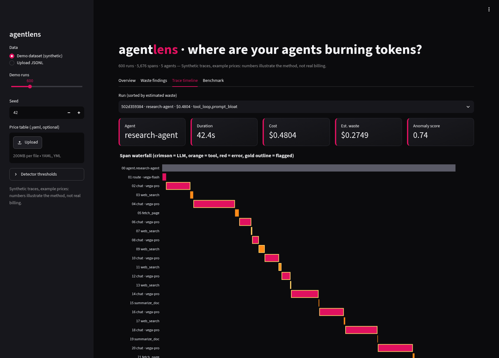
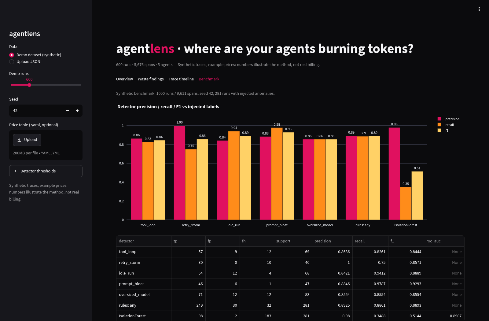
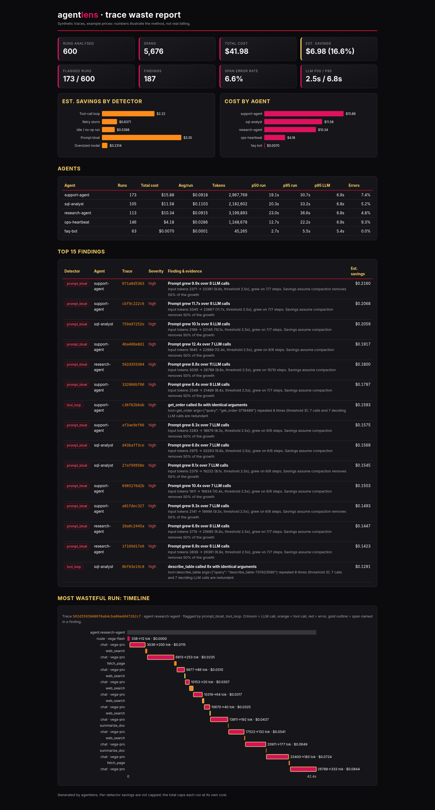

# agentlens · find the waste in your LLM agent traces

[](https://github.com/Shibukedang27/agentlens-trace-analyzer/actions/workflows/ci.yml)


AI agents quietly burn money: heartbeat runs that spend thousands of tokens to say "nothing happened",
tools called again and again with the same arguments, retry storms with no backoff, prompts that grow
every step because context is never compacted, and large models used for one-word routing decisions.
**agentlens** is a Python library, CLI and Streamlit dashboard that reads agent traces (JSONL spans that
loosely follow the OpenTelemetry GenAI conventions), computes cost, token, latency (p50/p95) and error
metrics per run, agent and model, flags waste with **five explainable rule-based detectors** (plus an
optional IsolationForest anomaly score), and estimates how much each fix would save. It runs fully
offline: no API keys, no network calls.

> **Honesty note: synthetic traces, example prices.** All data in this repo comes from a seeded
> synthetic generator, and the bundled price table uses fictional model names with illustrative prices.
> The dollar figures show how the method works; they are not real billing data.



## Demo results

Every number below is written by `scripts/update_readme.py` from files produced by running the code
(`results/eval_results.json`, `results/demo_report.json`). Nothing is typed by hand.

<!-- DEMO:START -->
| Demo dataset (`agentlens generate`, seed 42) | Value |
|---|---:|
| Runs / spans / agents | 600 / 5,676 / 5 |
| Total tokens | 9,644,207 |
| Total cost (example prices) | $41.98 |
| Estimated savings if flagged waste were fixed | $6.98 (16.6%) |
| Runs flagged / findings | 173 / 187 |
| LLM latency p50 / p95 | 2.48s / 6.85s |
| Span error rate | 6.6% |
<!-- DEMO:END -->

### Detector benchmark (`agentlens eval`)

<!-- RESULTS:START -->
Benchmark dataset: **1,000 synthetic runs / 9,611 spans** (seed 42), 281 runs with injected anomalies. Scores are run-level: a run counts as a true positive for a detector if the detector flags it and the generator injected that pattern.

| Detector | Support | Precision | Recall | F1 | F1 mean ± std (5 other seeds) |
|---|---:|---:|---:|---:|---:|
| `tool_loop` | 69 | 0.864 | 0.826 | **0.844** | 0.840 ± 0.028 |
| `retry_storm` | 40 | 1.000 | 0.750 | **0.857** | 0.937 ± 0.012 |
| `idle_run` | 68 | 0.842 | 0.941 | **0.889** | 0.901 ± 0.040 |
| `prompt_bloat` | 47 | 0.885 | 0.979 | **0.929** | 0.889 ± 0.029 |
| `oversized_model` | 83 | 0.855 | 0.855 | **0.855** | 0.825 ± 0.034 |
| any rule (run has any anomaly) | 281 | 0.892 | 0.886 | **0.889** | |
| IsolationForest (any anomaly) | 281 | 0.980 | 0.349 | **0.514** | ROC-AUC 0.891 |

**Throughput** (49,953 spans / 5,000 runs, median of 3 runs, Python 3.13.5, 8 CPUs): **34,178 spans/sec** for the full file pipeline (parse + metrics + 5 detectors + IsolationForest), 44,963 spans/sec without IsolationForest.
<!-- RESULTS:END -->

The generator deliberately makes this hard to ace: normal runs contain *benign look-alikes* (legit status
polling, one transient error retried with backoff, very short FAQ answers, healthy long research context,
a single short call on a large model) and about 15% of injected anomalies are *subtle*, below the default
thresholds. These cause the false positives and false negatives above, on purpose. The IsolationForest
is high-precision but low-recall, which is why it is a second signal, not the main detector.

## Quickstart

```bash
git clone https://github.com/Shibukedang27/agentlens-trace-analyzer.git
cd agentlens-trace-analyzer
python -m venv .venv && source .venv/bin/activate
pip install -e ".[dashboard,dev]"

agentlens generate                                   # 600 synthetic runs -> data/demo_traces.jsonl
agentlens analyze data/demo_traces.jsonl --report report.md --html report.html
agentlens trace data/demo_traces.jsonl <trace-id-prefix>   # one run as a span tree
agentlens eval                                       # precision/recall/F1 + throughput -> results/
streamlit run app/streamlit_app.py                   # dashboard
```

Use your own prices and thresholds with `--prices my_prices.yaml` (see
[`examples/prices.example.yaml`](examples/prices.example.yaml)). `--fail-on-waste 10` exits with code 2
when estimated waste is above 10% of spend, so the analyzer can gate a CI job that replays agent traces.

```python
from agentlens import analyze_file

result = analyze_file("data/demo_traces.jsonl")
print(result.summary["total_cost"], result.summary["est_savings"])
print(result.findings_df().sort_values("est_savings", ascending=False).head())
```



## Architecture



## Detectors

| Detector | Fires when (defaults) | Estimated saving |
|---|---|---|
| `tool_loop` | the same tool **succeeds** with identical arguments ≥ 3 times in a run (args compared as canonical JSON) | the redundant calls plus the LLM calls that decided them |
| `retry_storm` | ≥ 3 consecutive failures against the same tool or model; evidence reports the median gap and "no backoff" if < 500 ms | the failed attempts after the first (and their deciding LLM calls); rate-limited calls with 0 billed tokens save $0 |
| `idle_run` | a run with ≥ 300 input tokens, **no tool calls**, and ≤ 40 output tokens or an idle phrase such as "nothing happened" / `HEARTBEAT_OK` | the whole run: a cheap non-LLM pre-check could skip it |
| `prompt_bloat` | the main conversation (most-used model, prompts > 600 tokens) has ≥ 4 calls, grows ≥ 2.5x and grows on ≥ 80% of steps | 50% of the growth above the first prompt (assumed context compaction) |
| `oversized_model` | ≥ 2 successful calls on a `tier: large` model with ≤ 600 input and ≤ 50 output tokens | price difference vs the model's `downgrade_to` model |
| IsolationForest (optional) | outlier on run features (tokens, cost, calls, error rate, duration, max repeat, growth ratio), z-scored per agent | – (ranking signal only) |

Every finding carries the span ids and a plain-English evidence string, so you can check *why* a run was
flagged. All thresholds live in `DetectorConfig` and can be overridden from the `detectors:` section of the
price YAML or from the dashboard sidebar.

## Trace format

One JSON object per line. Simple names or OpenTelemetry GenAI attribute names (top level or inside
`attributes`) both work; timestamps can be ISO 8601 or epoch s/ms/µs/ns.

```json
{"trace_id": "a1", "span_id": "s2", "parent_id": "s1", "kind": "llm", "agent": "support-agent",
 "model": "orion-large", "input_tokens": 2140, "output_tokens": 96, "latency_ms": 1840.2,
 "status": "ok", "start_time": "2026-10-01T00:00:01.120Z", "end_time": "2026-10-01T00:00:02.960Z"}
{"trace_id": "a1", "span_id": "s3", "parent_id": "s1", "name": "tool.get_order",
 "start_time": "2026-10-01T00:00:03.000Z", "end_time": "2026-10-01T00:00:03.250Z", "status_code": "OK",
 "attributes": {"gen_ai.operation.name": "execute_tool", "gen_ai.tool.name": "get_order",
                "gen_ai.tool.call.arguments": "{\"id\": 7}"}}
```

Examples: [`examples/sample_traces.jsonl`](examples/sample_traces.jsonl) (simple names) and
[`examples/sample_traces_otel.jsonl`](examples/sample_traces_otel.jsonl) (OTel attribute names). Bad lines
are skipped and reported with their line number (`--strict` fails instead).

## Screenshots

All screenshots are real captures of the app and report running on the demo dataset (headless Chrome via
Playwright: `scripts/screenshots.py`, `scripts/render_terminal.py`).

| Waste findings | Single-trace waterfall |
|---|---|
|  |  |
| **Benchmark tab** | **Self-contained HTML report** |
|  |  |

## Project structure

```
agentlens-trace-analyzer/
├── src/agentlens/
│   ├── models.py        # Span / Run dataclasses
│   ├── parser.py        # JSONL(.gz) -> spans, OTel GenAI aliases, validation
│   ├── pricing.py       # YAML price table (bundled data/prices.yaml = EXAMPLE prices)
│   ├── metrics.py       # span/run/agent/model frames, p50/p95, error rates (pandas)
│   ├── detectors.py     # 5 explainable detectors + DetectorConfig
│   ├── anomaly.py       # IsolationForest run-level score
│   ├── analyzer.py      # parse -> metrics -> detectors -> capped savings
│   ├── report.py        # Markdown / JSON / self-contained HTML (inline SVG)
│   ├── generator.py     # seeded synthetic traces with labeled anomalies
│   ├── evaluate.py      # precision/recall/F1, seed robustness, throughput
│   └── cli.py           # agentlens generate | analyze | trace | eval
├── app/streamlit_app.py # dashboard: KPIs, cost by agent, findings, waterfall, benchmark
├── tests/               # pytest suite
├── results/             # real benchmark + demo report outputs
├── examples/            # sample traces (both formats) and price table
├── scripts/             # screenshots, terminal render, README number updater
└── .github/workflows/ci.yml  # ruff + pytest on Python 3.10 / 3.11 / 3.12
```

## Testing

<!-- TESTS:START -->
**69 pytest tests, all passing, 98% line coverage** (parser, pricing, metrics, every detector, generator, eval, CLI, reports and a Streamlit smoke test).
<!-- TESTS:END -->

CI runs `ruff check`, `ruff format --check`, the test suite on Python 3.10, 3.11 and 3.12, and a CLI
smoke test.

```bash
pytest --cov=agentlens
ruff check . && ruff format --check .
```

## Limitations

- **Synthetic evaluation.** Precision/recall are measured against labels from this repo's own generator.
  Real agent traces will have patterns it does not model, so treat the scores as a sanity check of the
  detectors' logic, not as real-world accuracy.
- **Example prices.** Model names and prices are fictional. Plug in your provider's real prices before
  trusting any dollar figure.
- **Savings are estimates** built on stated assumptions (e.g. compaction removes 50% of prompt growth, an
  idle run could be skipped entirely). Per-run savings are capped at the run's cost to avoid double counting.
- **Heuristic thresholds.** Legit polling looks like a tool loop and a short FAQ answer can look idle; tune
  `DetectorConfig` for your agents.
- Works on exported trace files (batch). It is not a live OTLP collector, and it does not inspect prompt or
  tool content beyond tool arguments and an optional output preview.

## License

MIT, see [LICENSE](LICENSE). Built by Mithilesh Kodali.
